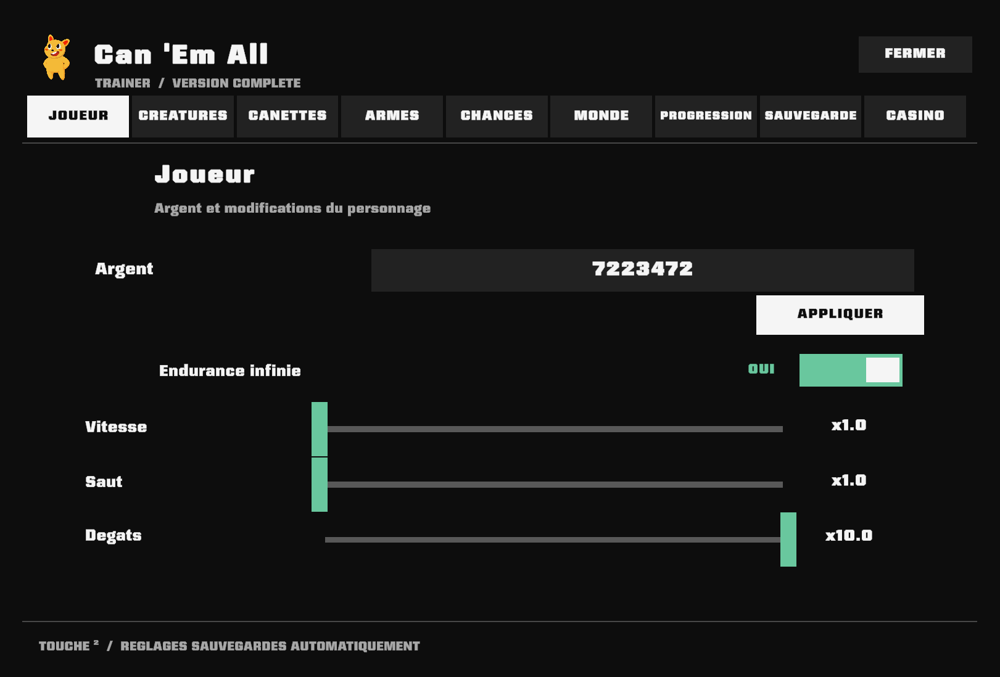

# Can 'Em All — In-Game Trainer

An unofficial **MelonLoader mod for the full Windows release of Can 'Em All**. It adds a nine-tab menu directly inside the game. No separate trainer executable or account is required.

**[Download the latest release](https://github.com/BreezeDelegate/can-em-all-trainer/releases/latest)** · [Installation](#installation) · [Controls](#controls) · [Known limitations](#known-limitations)

> **Language:** The menu supports **English and French** in one DLL. English is the default on fresh installs. Choose **EN** or **FR** beside Close to switch instantly; the choice is saved.
>
> **Single-player use.** This is an independent community project, not affiliated with LuisDev.

## Menu preview

*Real in-game screenshot of the v7.2 French interface. Starting with v7.3, the menu has an EN / FR selector beside Close. The screenshot does not depict that new control.*

## What it does

| Menu tab | Functions |
| --- | --- |
| **Player** (Joueur) | Money, stamina, player speed, jumping and damage |
| **Creatures** (Créatures) | Select and spawn available creature models |
| **Cans** (Canettes) | Spawn cans using the game's object pool |
| **Weapons** (Armes) | Unlock/select weapons, add ammunition, safe automatic ammo supply |
| **Chances** (Probabilities) | Adjust critical hits and selected combat/production odds |
| **World** (Monde) | Adjust day/night duration, conveyor, truck count and clock; equipment controls |
| **Progression** | Purchase normal research upgrades while leaving the final exit unlock alone |
| **Save** (Sauvegarde) | Read game statistics |
| **Casino** | Change slot-machine odds *once the casino is available in the game* |

**Monde → Équipement** also offers turret ammo supply, vacuum capacity/throw rate and flamethrower range.

## Installation

**Requirements:** full Steam game on **Windows**, with **MelonLoader 0.7.3**. This mod does **not** target the separately released demo.

1. Back up your game save before changing any progression.
2. Install [MelonLoader 0.7.3](https://github.com/LavaGang/MelonLoader/releases/tag/v0.7.3) for the **full game's executable**. Run the game once and exit to initialize the loader.
3. Download **CanEmAll-Trainer-v7.3.0-Windows.zip** from the [Releases page](https://github.com/BreezeDelegate/can-em-all-trainer/releases/tag/v7.3.0).
4. Extract the ZIP **into the game's root folder** (Steam → the game → Properties → Installed Files → Browse). The final file must be `<game folder>/Mods/CanEmAllFullMod.dll`.
5. Start the game and press the **physical key immediately to the left of 1, underneath Esc** to open/close the menu (² on French AZERTY keyboards; backtick/tilde on many QWERTY keyboards). Select **EN** or **FR** beside the Close button.

The game is typically installed in `steamapps/common/Can 'Em All/`. Do not copy the DLL into `MelonLoader/` or the game's demo directory.

## Controls

- **² / the physical key below Esc** — open or close the trainer.
- **EN / FR** in the top-right corner — change the menu language without restarting, saved between sessions.
- **Click the money field** — edit a value. Use Enter to apply; Ctrl+A / Ctrl+V for selection/paste.
- **Shift + click** on numerical +/- controls — change the value by 10 instead of 1.
- **Monde → Équipement** — optional controls for turret supply, vacuum and flamethrower.
- **Progression → Tout débloquer** — purchase ordinary research upgrades. The ultimate exit unlock is intentionally excluded.

## Known limitations

- The UI includes English and French in one release. Other languages are not supported yet.
- The trainer **does not unlock the casino**, permanent prestige upgrades, or the final exit/ultimate unlock. Casino probability settings only apply when the slot machine exists.
- Automatic ammo supply deliberately avoids melee weapons and weapons with delicate reload sequences, including the rocket launcher.
- Not every feature has been interactively tested across all game versions, weapons, scenes or save states. Compatibility after game updates is not guaranteed.
- The mod can affect progression, achievements and save-state expectations. **Back up your save.**

## Uninstall and troubleshooting

With the game closed, remove `Mods/CanEmAllFullMod.dll`. Uninstalling the trainer does **not** undo gameplay or progression changes. Optional preferences may remain in `UserData/CanEmAllTrainer.ini`.

If it doesn't load, verify you're playing the **full game**, MelonLoader is installed correctly, and only one copy of this trainer DLL exists. Logs are in `MelonLoader/Logs/`.

When reporting a bug, include the game's build/version, the MelonLoader version, the affected tab or weapon, and relevant log lines (remove personal paths first).

## Source, verification and attribution

The `src/` directory contains the mod's C# source. The release archive contains only **our mod DLL and installation instructions**; it does not bundle MelonLoader, Unity assemblies, save files or proprietary game art. Game UI sprites are used from the user's installed game at runtime.

The 7.2.0 candidate passed 24 focused regression checks, 15 managed preferences tests and a headless Unity test of 180 tab changes without logged mod errors. The bilingual v7.3.0 adds localization unit tests and a native English/French switch smoke test. These checks **are not** a guarantee that every game action or visual state works.

The project was developed with substantial AI-assisted programming and iterative runtime testing. No repository license has yet been selected; publication of source is not a blanket permission for redistribution or derivative works.
